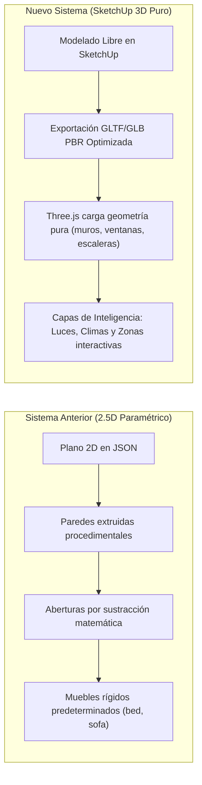

# 🏛️ Plan Maestro de Implementación: House Control 3D Nativo (SketchUp Engine)

Este documento establece la arquitectura técnica, hoja de ruta, análisis de viabilidad, resolución de fallas lógicas y mejores prácticas para transformar **House Control** de su sistema actual 2.5D procedimental a un **motor 3D puro basado en SketchUp**.

---

## 🎯 1. Visión General del Cambio de Paradigma



### Lo que eliminamos:
- ❌ **Sustracción rígida de muros y aberturas**: No más cálculos de puertas/ventanas como cajas sustractivas flotantes.
- ❌ **Catálogo de muebles fijos y hardcoded**: Se eliminan las limitaciones de tipos (`bed`, `sofa`, `pillow`).
- ❌ **Estructura 2.5D limitada**: Ahora se permiten techos inclinados, losas, doble altura, balcones, fachadas, terrazas y escaleras reales.

### Lo que conservamos y potenciamos:
- ✅ **Motor de iluminación interactiva**: Control de brillo, temperatura (2700K - 6500K), color RGB y sincronización Tuya / Smart Life / Home Assistant / Hue.
- ✅ **Simulación de climatización (HVAC)**: Termostatos interactivos, flujo visible de aire, partículas de frío/calor y oscilación.
- ✅ **Zonificación por espacios/habitaciones**: Agrupación de dispositivos por recámara, sala, cocina, patio, etc.
- ✅ **Sincronización bidireccional Wi-Fi**: Transferencia en tiempo real PC ⇄ Celular ya establecida en los puertos `8765` y `8766`.

---

## 🔍 2. Análisis Crítico: Fallos en la Lógica y Soluciones Técnicas

| Desafío / Fallo Potencial | Causa del Problema | Solución Técnica (Best Practice) |
| :--- | :--- | :--- |
| **1. Colapso de rendimiento móvil (OOM)** | Los modelos de 3D Warehouse suelen tener 100,000+ polígonos y texturas sin comprimir de 4K/8K. Exportar varios muebles satura la GPU/RAM del celular. | **Presupuesto poligonal estricto y compresión Draco/Meshopt**. El plugin de SketchUp inspeccionará y alertará si un componente supera los 15,000 polígonos, convirtiendo texturas a WebP de 1K/2K. |
| **2. Pérdida de "Habitaciones" (Zonas)** | Al no haber muros procedimentales en 2D, el motor WebGL no sabe dónde termina la "Sala" y dónde empieza la "Cocina" para enfocar la cámara o agrupar luces. | **Planos o Volúmenes delimitadores con Tags (`HC_Zona_Sala`)**. En SketchUp solo se pinta o asigna un Tag/Capa al piso del espacio. El exportador detecta el plano delimitador y calcula automáticamente el centro y cámara de esa habitación. |
| **3. Clics e interacción táctil en el celular** | En un modelo 3D complejo, al tocar una lámpara con el dedo en la pantalla, el raycaster de Three.js puede seleccionar el foco equivocado o chocar con cristales/muros. | **Proxy Colliders invisibles**: El plugin asigna una caja o esfera simplificada oculta (`isCollider: true`) a las luces y aires acondicionados para que el toque táctil sea 100% preciso e instantáneo. |
| **4. Normales invertidas y Caras Azules** | En SketchUp es muy común modelar caras al revés (cara posterior gris/azul visible). En Three.js esto produce muros transparentes (*Backface Culling*). | **Doble cara automática en exportador**: El exportador forzará `material.side = THREE.DoubleSide` en el GLTF para elementos de muros/fachada, o corregirá automáticamente las normales hacia afuera en SketchUp. |

---

## 🏗️ 3. Formato y Pipeline de Datos Propuesto: GLB Híbrido

Para compatibilizar SketchUp con Three.js en Android, el mejor estándar internacional es **GLB (glTF 2.0 Binary)** con metadatos embebidos en el nodo `extras`:

```json
{
  "asset": { "version": "2.0", "generator": "HouseControl-SketchUp-Engine" },
  "extras": {
    "houseControl": {
      "version": "2.0.0",
      "name": "Residencia Pavon",
      "rooms": [
        { "id": "living", "name": "Sala de Estar", "floorElevation": 0.0, "center": [2.5, 0.0, 3.2] }
      ],
      "devices": [
        {
          "nodeName": "Lampara_Techo_Sala",
          "type": "light",
          "lightType": "spot",
          "room": "living",
          "tuyaId": "eb12345678",
          "homeAssistantEntity": "light.sala_principal",
          "color": "#FFF4E0",
          "intensity": 1.0,
          "targetElevation": 2.4
        },
        {
          "nodeName": "MiniSplit_Recamara",
          "type": "ac",
          "room": "recamara",
          "tuyaId": "eb98765432",
          "targetTemp": 22
        }
      ]
    }
  }
}
```

> [!TIP]
> **Ventaja del GLB:** En un solo archivo binario viajan los vértices, normales, coordenadas UV, materiales PBR, mapas de textura comprimidos y el diccionario completo de dispositivos domóticos.

---

## 📦 4. Integración con 3D Warehouse y Catálogo Limpio

### Reglas de Curaduría para la Galería 3D:
1. **Librería de Componentes Low-Poly:**
   - Crear una colección interna organizada en carpetas:
     - `01_Iluminacion/` (Lámparas de techo, spots empotrados, lámparas de pie, tiras LED).
     - `02_Climatizacion/` (Minisplits, rejillas de ducto, ventiladores de techo).
     - `03_Mobiliario/` (Salas, comedores, camas, escritorios, cocinas).
     - `04_Vegetacion/` (Plantas de interior, macetas optimizadas).
     - `05_Vehiculos_Decoracion/` (Autos, cuadros, alfombras).
2. **Atributos Dinámicos de SketchUp (`AttributeDictionary`):**
   - Cuando el usuario inserta un objeto desde el catálogo del plugin, ya viene pre-etiquetado:
     - `dict['HouseControl']['category'] = 'light'`
     - `dict['HouseControl']['interactive'] = true`
   - Si el usuario descarga cualquier modelo directamente desde **3D Warehouse**, solo hace clic derecho → **«Convertir a Objeto House Control»** y selecciona qué tipo de elemento es y con qué dispositivo real se conecta.

---

## 🚀 5. Nuevas Funciones Propuestas para Potenciar la App

1. **Simulación de Luz Solar Dinámica (Ciclo Día / Noche):**
   - Como el modelo ahora tiene ventanas 3D reales y techo, podemos calcular la posición del sol real basada en la geolocalización y hora de la casa.
   - De día, los rayos de sol entran por las ventanas con sombras suaves; de noche, la casa se oscurece y cobran protagonismo las lámparas reales.
2. **Puertas y Ventanas Interactivas:**
   - Si un componente tiene la etiqueta `HC_Puerta`, un toque en el celular reproduce una animación de apertura en 90° con pivote real.
3. **Puntos de Cámara Guardados (Escenas de SketchUp):**
   - Las pestañas de **Escenas** que crees en SketchUp (*"Perspectiva Sala"*, *"Vista Aérea General"*, *"Detalle Cocina"*) se exportan al celular como botones de acceso rápido para volar suavemente la cámara a ese ángulo.
4. **Modo Visita en Primera Persona (Walkthrough):**
   - Joystick virtual en pantalla para caminar por dentro de la casa a la altura de los ojos (1.65 m) con detección de colisión contra los muros 3D de SketchUp.
5. **Modo Realidad Aumentada (AR):**
   - Proyectar la maqueta 3D interactiva de tu casa sobre la mesa de tu oficina usando ARCore en Android.

---

## 📅 6. Hoja de Ruta de Implementación (Fases)

### Fase 1: Motor de Exportación GLB en el Plugin de SketchUp
- [ ] Integrar el exportador binario GLTF 2.0 en Ruby (`exporter_glb.rb`).
- [ ] Mapear jerarquía de componentes, nombres de capas/tags y diccionarios de atributos.
- [ ] Optimizar mallas (unificar materiales compartidos y aplicar compresión básica).

### Fase 2: Adaptación del Visor Three.js en la App Android
- [ ] Reemplazar los constructores procedimentales (`Wall.js`, `Room.js` 2.5D) por `THREE.GLTFLoader`.
- [ ] Crear el parser de `extras.houseControl`: instanciar las luces virtuales exactamente en las posiciones `[x, y, z]` de las lámparas 3D.
- [ ] Vincular el shader de flujo de aire a la cara frontal de los modelos de Minisplit.
- [ ] Implementar delimitadores de habitaciones por tags para mantener el panel de control por habitaciones.

### Fase 3: Catálogo Curado de 3D Warehouse
- [ ] Descargar y optimizar biblioteca inicial de 60 modelos esenciales (iluminación, mobiliario básico, climas).
- [ ] Empaquetar miniaturas WebP para el catálogo visual estilo Lumion.
- [ ] Añadir herramienta en SketchUp: *"Auditor de Polígonos"* que avise si un modelo descargado de 3D Warehouse es demasiado pesado antes de exportar.

### Fase 4: Pruebas de Rendimiento y Pulido
- [ ] Prueba de carga con casas de 2 y 3 plantas.
- [ ] Verificación de sincronización Wi-Fi en 1 clic enviando el archivo GLB completo.
- [ ] Calibración de sombras dinámicas y reflejos en pisos de porcelanato y madera.
