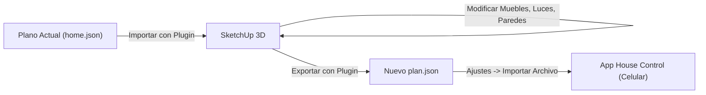

# Guía de Sincronización: House Control 3D ⇄ Trimble SketchUp

Esta guía explica el formato de planta que utiliza la app **House Control**, cómo funciona el plugin desarrollado para **SketchUp**, la nueva biblioteca **Catálogo Lumion de Objetos y Materiales 3D**, y el flujo de trabajo para diseñar y exportar sin perder información domótica.

---

## 1. Catálogo Lumion 3D (Objetos y Materiales)

El plugin incluye una ventana interactiva desarrollada con la estética, fluidez y funciones de la **biblioteca de objetos de Lumion**:

### Características principales:
* **Tema Dark Glassmorphism:** Interfaz oscura, iconos iluminados en cian neón y dorado, y previsualizaciones isométricas 3D en tiempo real.
* **Colocación con 1 clic (Estilo Lumion):** Al hacer clic en **"Colocar"**, el cursor de SketchUp se convierte automáticamente en la herramienta interactiva de posicionamiento con el componente 3D cargado, permitiéndote hacer clic en cualquier parte de tu plano para situarlo y rotarlo con precisión.
* **Modo Colocación Múltiple:** Interruptor para colocar múltiples copias continuas (por ejemplo varias sillas o lámparas de techo) con un solo clic.
* **Asignación Automática a Habitaciones:** Selector de habitación activa (`Salón`, `Dormitorio`, `Cocina`, `Baño`, `Oficina`, `Terraza`, etc.) para que cada objeto colocado quede registrado automáticamente en el sistema domótico.
* **Inspector y Personalizador:** Botón para ajustar dimensiones ($W \times D \times H$), tono de acabado y vinculación Tuya / Smart Life antes de colocar.

### Categorías de Objetos disponibles:
1. 🛋️ **Mobiliario (Living / Salón):** Sofás de 3 plazas, sofás seccionales en L con chaise lounge, sillones individuales tipo butaca, mesas de centro de madera y metal, mesas auxiliares, muebles TV consola con pantalla plana, mesas de comedor rectangulares y redondas con sillas, alfombras de salón con bordes suavizados, libreros modernos y escritorios de trabajo.
2. 🛏️ **Dormitorio:** Camas King, Queen e Individuales con cabeceras de madera, colchón biselado, almohadas acolchadas y edredón; burós de noche con cajón y tirador, cómodas de 6 cajones y armarios roperos empotrados.
3. 💡 **Iluminación Domótica:** Plafones LED circulares de techo, lámparas colgantes nórdicas con esfera difusora, rieles de 3 focos direccionales (spots), lámparas de pie contemporáneas, lámparas de mesa y sobremesa, tiras LED lineales y apliques de pared contemporáneos (todos vinculables a Tuya / Smart Life).
4. 🍳 **Cocina:** Módulos de cocina completa con encimera de piedra, islas centrales con barra de desayuno, refrigeradores verticales de acero inoxidable y bancos altos de barra.
5. 🛁 **Baño y Sanitarios:** Bañeras exentas con esquinas curvas y grifería monomando, cabinas de ducha con mampara de cristal templado y cabezal de lluvia, inodoros con cisterna y muebles lavamanos con espejo iluminado.
6. 🌿 **Naturaleza y Plantas:** Plantas de interior en maceta, ficus decorativos en macetero cerámico y sansevierias altas.
7. ❄️ **Climatización (HVAC):** Mini-splits de pared con rejilla inferior y display LED, y rejillas difusoras de techo.
8. 🚗 **Vehículos:** Sedán ejecutivo moderno y SUV todoterreno con ruedas, cristales tintados y carrocería paramétrica.

### Catálogo de Materiales Arquitectónicos Lumion:
Pestaña dedicada con más de **30 materiales arquitectónicos** listos para aplicar:
* **Maderas:** Roble Europeo, Nogal Americano, Teca, Fresno Claro, Ébano Carbón, Madera Blanca Decapé.
* **Piedras y Porcelanatos:** Mármol Carrara Blanco, Granito Negro Galaxy, Pizarra Gris, Azulejo Satinado Blanco, Terrazo Veneciano, Microcemento Pulido.
* **Metales:** Aluminio Negro Mate, Latón Dorado Cepillado, Cromo Espejo, Acero Inoxidable, Cobre Cepillado, Bronce Arquitectónico.
* **Cristales:** Vidrio Cristalino, Vidrio Smart Azul, Vidrio Fumé Ahumado, Vidrio Esmerilado.
* **Pinturas de Muro:** Blanco Cálido, Blanco Nieve, Gris Neutro, Azul Medianoche, Verde Salvia, Terracota, Antracita.
* **Telas y Tapicería:** Lino Gris Perla, Lino Azul Marino, Cuero Caramelo Vintage, Terciopelo Esmeralda, Terciopelo Mostaza, Tapicería Marengo.

> **Uso del Catálogo de Materiales:** Al hacer clic sobre cualquier muestra de material, si tienes caras o grupos seleccionados en SketchUp se les aplica de inmediato; además, el material queda automáticamente activo en la herramienta **Cubo de Pintura (Tecla `B`)** para pintar libremente.

---

## 2. ¿Qué formato de importación necesita la app?

La app House Control importa archivos en formato **JSON** (habitualmente llamados `plan.json` o `home.json`).

### Características técnicas del formato:
* **Unidad de medida:** **Metros (m)** con decimales (por ejemplo, una pared de 4.20 m es `4.2`).
* **Sistema de coordenadas (Three.js):**
  * `X`: Eje horizontal (Este/Oeste).
  * `Z`: Eje de profundidad (Norte/Sur).
  * `Y`: Altura sobre el suelo (`0` es el suelo, `2.6` es el techo).
* **Estructura principal del JSON:**
  1. **Metadatos generales:**
     * `"name"`: Nombre de la casa (ej: `"Casa Alex"`).
     * `"wallHeight"`: Altura de muros perimetrales (ej: `2.6` m).
     * `"interiorWallHeight"`: Altura de muros divisores interiores (ej: `1.25` o `2.6` m).
     * `"outdoorTemp"`: Temperatura exterior (°C).
     * `"camera"`: Ángulo inicial de cámara `{ "azimuth": 34, "elevation": 47 }`.
  2. **`rooms` (Habitaciones):**
     * Cada habitación define su rectángulo perimetral: `"rect": [x, z, ancho, profundidad]`.
     * `"floor"`: Material del piso (`"oak"`, `"walnut"`, `"tile"`, `"stone"`).
  3. **`openings` (Puertas y Ventanas):**
     * `"type"`: `"door"` (puerta), `"window"` (ventana), `"open"` (vano abierto).
     * `"from": [x1, z1]`, `"to": [x2, z2]`.
     * `"sill"`: Altura de antepecho (ej: `0.85` m).
     * `"head"`: Altura de dintel (ej: `2.10` m).
  4. **`furniture` (Mobiliario):**
     * `"type"`: Tipo de mueble o vehículo.
     * `"pos": [x, z]`, `"rot": grados`, `"color"`, `"width"`, `"size"`.
  5. **`lights` (Iluminación):**
     * `"id"`: Identificador único (ej: `"living.main"`).
     * `"room"`: Habitación a la que pertenece.
     * `"type"`: `"ceiling"`, `"pendant"`, `"spots"`, `"floor"`, `"table"`, `"strip"`, `"wall_sconce"`.
     * `"pos": [x, z]`, `"y": altura`.
     * `"capabilities"`: Capacidades (`["brightness", "temp"]` o `["brightness", "color"]`).
     * `"link"` o `"tuya"`: **Enlace con el dispositivo físico real** (Smart Life / Tuya).
  6. **`acs` (Aires Acondicionados):**
     * `"id"`: Ej. `"living.ac"`.
     * `"room"`, `"wall"` (`"north"`, `"south"`, `"east"`, `"west"`), `"pos": [x, z]`, `"y": 2.2`.
     * `"link"`, `"tuya"` o `"sensor"` (termómetro asociado).
  7. **`scenes` (Escenas):**
     * Ambientes preconfigurados como "Bright", "Cozy", "Movie", "Night", "Away".

---

## 3. El Plugin para SketchUp: House Control 3D Sync

Instalado directamente en tus instalaciones de SketchUp (compatible con **SketchUp 2022, 2023 y 2025**).

### ¿Cómo garantiza que no se pierda información?
SketchUp cuenta con un sistema nativo llamado **Attribute Dictionaries** (`attribute_dictionaries`):
1. Al importar el plano JSON a SketchUp o al insertar objetos desde el **Catálogo Lumion**, cada grupo y componente 3D recibe una etiqueta digital con:
   * Su ID único.
   * Su nombre y habitación asignada.
   * La vinculación exacta al dispositivo real de **Smart Life / Tuya**.
   * Medidas reales y color aplicado.
2. Tú puedes mover muebles con la herramienta **Mover (`M`)**, rotarlos con **Rotar (`Q`)**, reubicar lámparas o ajustar muros con la comodidad y precisión de SketchUp.
3. Al presionar **Exportar a House Control (*.json)**, el plugin lee las nuevas posiciones físicas 3D de SketchUp, las convierte a metros y las reempaqueta con todos los datos y enlaces intactos.

---

## 4. Flujo de Trabajo Paso a Paso

### Paso 1: Abrir SketchUp y el Catálogo Lumion
1. Abre tu versión preferida de SketchUp (2022, 2023 o 2025).
2. Verás la barra de herramientas **House Control 3D** con el icono brillante del cubo Lumion.
3. Haz clic en **🏛️ Catálogo de Objetos y Materiales (Estilo Lumion)...**.
4. Navega por las categorías, busca por nombre o filtra por estancias.
5. Haz clic en **"Colocar"** y haz clic sobre tu suelo en SketchUp para situar el objeto donde desees.

### Paso 2: Exportar el Plano Modificado
1. En SketchUp, haz clic en **Exportar a House Control (*.json)...**.
2. Guarda tu archivo (por ejemplo `mi_nuevo_diseno.json`).

### Paso 3: Cargar en tu Celular
1. Envía el archivo a tu celular (WhatsApp, Google Drive o cable USB).
2. Abre la app **House Control** en tu teléfono.
3. Entra a **Ajustes** (icono de deslizadores arriba a la derecha).
4. Toca en **"Import file" (Importar archivo)** y selecciona tu archivo.
5. ¡Listo! La app cargará inmediatamente tu nuevo plano 3D con todas las luces, climas y automatizaciones funcionando sobre tu nuevo diseño.
