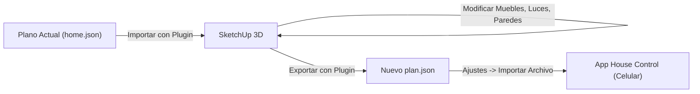

# Guía de Sincronización: House Control 3D ⇄ Trimble SketchUp

Esta guía explica el formato de planta que utiliza la app **House Control**, cómo funciona el plugin desarrollado para **SketchUp** y el flujo de trabajo para editar tu modelo en SketchUp sin perder información de dispositivos ni de configuración.

---

## 1. ¿Qué formato de importación necesita la app?

La app House Control importa archivos en formato **JSON** (habitualmente llamados `plan.json` o `home.json`).

### Características técnicas del formato:
* **Unidad de medida:** **Metros (m)** con decimales (por ejemplo, una pared de 4.20 m es `4.2`).
* **Sistema de coordenadas (Three.js):**
  * `X`: Eje horizontal (Este/Oeste).
  * `Z`: Eje de profundidad (Norte/Sur).
  * `Y`: Altura sobre el suelo (`0` es el suelo, `2.6` es el techo).
* **Estructura principal del JSON:**
  1. **Metadatos generales:**
     * `"name"`: Nombre de la casa (ej: `"Casa Alex"`).
     * `"wallHeight"`: Altura de muros perimetrales (ej: `2.6` m).
     * `"interiorWallHeight"`: Altura de muros divisores interiores (ej: `1.25` o `2.6` m).
     * `"outdoorTemp"`: Temperatura exterior (°C).
     * `"camera"`: Ángulo inicial de cámara `{ "azimuth": 34, "elevation": 47 }`.
  2. **`rooms` (Habitaciones):**
     * Cada habitación define su rectángulo perimetral: `"rect": [x, z, ancho, profundidad]`.
     * `"floor"`: Material del piso (`"oak"`, `"walnut"`, `"tile"`, `"stone"`).
  3. **`openings` (Puertas y Ventanas):**
     * `"type"`: `"door"` (puerta), `"window"` (ventana), `"open"` (vano abierto).
     * `"from": [x1, z1]`, `"to": [x2, z2]`.
     * `"sill"`: Altura de antepecho (ej: `0.85` m).
     * `"head"`: Altura de dintel (ej: `2.10` m).
  4. **`furniture` (Mobiliario):**
     * Tipos admitidos: `sofa`, `armchair`, `coffeeTable`, `tv`, `diningSet`, `kitchen`, `island`, `fridge`, `bed`, `nightstand`, `dresser`, `plant`, `vanity`, `bathtub`, `toilet`, `desk`, `wardrobe`, `bookshelf`, `rug`.
     * `"pos": [x, z]`, `"rot": grados`, `"color"`, `"width"`.
  5. **`lights` (Iluminación):**
     * `"id"`: Identificador único (ej: `"living.main"`).
     * `"room"`: Habitación a la que pertenece.
     * `"type"`: `"ceiling"` (techo), `"pendant"` (colgante), `"spots"` (focos), `"floor"` (de pie), `"table"` (sobremesa), `"strip"` (tira LED).
     * `"pos": [x, z]`, `"y": altura`.
     * `"capabilities"`: Capacidades (`["brightness", "temp"]` o `["brightness", "color"]`).
     * `"link"` o `"tuya"`: **Enlace con el dispositivo físico real** (Smart Life, Home Assistant o Philips Hue).
  6. **`acs` (Aires Acondicionados):**
     * `"id"`: Ej. `"living.ac"`.
     * `"room"`, `"wall"` (`"north"`, `"south"`, `"east"`, `"west"`), `"pos": [x, z]`, `"y": 2.2`.
     * `"link"`, `"tuya"` o `"sensor"` (termómetro asociado).
  7. **`scenes` (Escenas):**
     * Ambientes preconfigurados como "Bright", "Cozy", "Movie", "Night", "Away".

---

## 2. El Plugin para SketchUp: House Control 3D Sync

Hemos programado e instalado la extensión **House Control 3D Sync** directamente en tus instalaciones de SketchUp (compatible con **SketchUp 2022, 2023 y 2025**).

### ¿Cómo garantiza que no se pierda información?
SketchUp cuenta con un sistema nativo llamado **Attribute Dictionaries** (`attribute_dictionaries`):
1. Al importar el plano JSON a SketchUp, cada grupo 3D (habitación, muro, mueble, lámpara o clima) recibe una "etiqueta digital oculta" con:
   * Su ID único.
   * Su nombre y habitación asignada.
   * La vinculación exacta al dispositivo real de **Smart Life / Tuya**, **Home Assistant** o **Philips Hue**.
   * Las escenas y configuraciones de color/brillo.
2. Tú puedes mover muebles con la herramienta **Mover (`M`)**, rotarlos con **Rotar (`Q`)**, reubicar lámparas o ajustar muros con la comodidad y precisión de SketchUp.
3. Al presionar **Exportar a House Control (*.json)**, el plugin lee las nuevas posiciones físicas 3D de SketchUp, las convierte a metros y las reempaqueta con todos los datos y enlaces intactos.

---

## 3. Flujo de Trabajo Paso a Paso

### Paso 1: Abrir SketchUp e Importar
1. Abre tu versión preferida de SketchUp (2022, 2023 o 2025).
2. Verás una nueva barra de herramientas llamada **House Control 3D** (o en el menú superior **Extensiones → House Control 3D**).
3. Haz clic en **Importar Plano House Control (*.json)...**.
4. Selecciona un archivo de plano, por ejemplo:
   `c:\PROYECTOS ANTIGRAVITY\house-control-sketchup-sync\sample_plans\home.json`
5. SketchUp creará automáticamente los pisos por material, muros con aberturas, muebles, lámparas y equipos de clima organizados en sus respectivas capas/tags (`HC_Pisos`, `HC_Paredes`, `HC_Muebles`, `HC_Luces`, `HC_Climas`).

### Paso 2: Editar en SketchUp
* **Mover o rotar muebles/luces:** Usa la herramienta Mover (`M`) y Rotar (`Q`).
* **Ver información de un dispositivo:** Selecciona cualquier elemento y presiona el botón **"Inspeccionar Datos del Elemento"** de la barra de herramientas. Te mostrará su ID, su habitación y si está vinculado a Smart Life, Home Assistant o Hue.

### Paso 3: Exportar el Plano Modificado
1. En SketchUp, haz clic en **Exportar a House Control (*.json)...**.
2. Elige dónde guardar tu archivo (por ejemplo `mi_casa_modificada.json`).

### Paso 4: Cargar en tu Celular
1. Envía el archivo `mi_casa_modificada.json` a tu celular (por WhatsApp, Drive o cable).
2. Abre la app **House Control** en tu teléfono.
3. Entra a **Ajustes** (icono de deslizadores arriba a la derecha).
4. Toca en **"Import file" (Importar archivo)** y selecciona tu archivo.
5. ¡Listo! La app cargará inmediatamente tu nuevo plano 3D con todas las luces, climas y automatizaciones funcionando sobre tu nuevo diseño.
